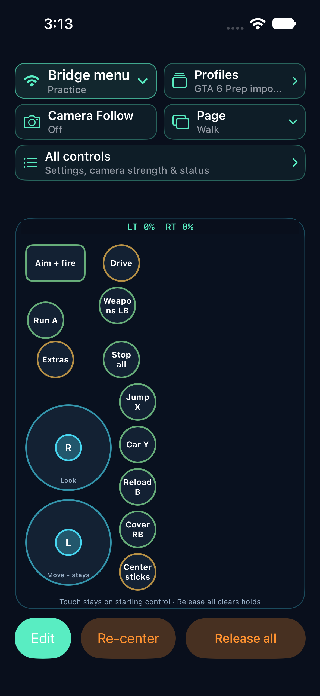

# Simple Controller for iPhone

Simple Controller turns an iPhone into a customizable, one-finger controller. Place buttons and sticks where they are comfortable and try them in Practice. **Version 0.21.0 (build 28)** includes four editable game starters, Macro Mode, and adjustable automatic release.

**[Download the complete iPhone source ZIP](https://github.com/kortorder/simplecontroller-ios/raw/refs/heads/main/SimpleController-iOS-0.21.0-source.zip)** · [Editable Git bundle](https://github.com/kortorder/simplecontroller-ios/raw/refs/heads/main/SimpleController-iOS-0.21.0.bundle) · [SHA-256 checksums](SHA256SUMS.txt)

## Staying connected

Changing pages or profiles releases held actions and prepares a fresh, neutral bridge session automatically. Editing controls and releasing all actions do not require another tap on Connect. The app remembers the connection through short interruptions, then reconnects with all controls released when you return. Leaving the app for five minutes means you must tap **Connect** again. **Disconnect** or switching to **Practice** ends the connection immediately.

Reconnection still requires a reachable bridge and the configured output capabilities. It does not restore held buttons, sticks, macros, or trigger pressure.

## Macro Mode and automatic release

In Edit, hold an ordinary button and turn on **Macro Mode**. One tap completes its timed actions after you lift your finger. Actions default to **200 ms** and release automatically. Add `(U100)` to give an action a 100 ms press. For example, `X360A(U100),X360A(D500)(U100),X360B(D800)(U100)` makes two separate A presses followed by B. Each D is measured from the initial touch. **Release all** cancels the sequence.

Macro Mode can be selected separately for each ordinary button. Hold to toggle, Auto-Tap and advanced button modes are separate choices for that button.

## Try a game starter
On first launch, choose Shooter, Racing, Sports or Open World. To try another layout, tap **Profiles → Game starters** and choose a category. Each choice opens an editable personal copy.

Shooter includes independent Aim and Fire and a combined pad. Racing lets one finger steer while pressing the throttle or brake. Sports offers movement, short and long passes, shooting and sprint. Open World has On foot and Drive pages. Every starter includes a Menus page with the Xbox D-pad, A, B, Menu and View. Button assignments depend on the game. On the iPhone Xbox bridge, after changing pages tap **Bridge menu → Connect bridge** to resume.

## Controller options

- Commands can run immediately, on release, after a delay, with repeat, or with a release delay. For example, `LT:0.5(HRD200)` keeps a half-pressed left trigger for 200 milliseconds after lift. Touch Aim tracks held stages as your fingertip lifts.
- Each manual Touch Aim stage can have its own aiming sensitivity and entry confirmation time. Sensor actions still require local setup.
- Floating rings can use compact boost bands, separate movement and aiming actions and distances, direct fine aim, and an optional delay bypass for a direct Boost 2 touch. Finish can require a direct tap.
- Existing saved layouts keep their settings. Full-forward repeated A and the direct Aim + fire pad are included in the GTA 6 Prep example.

## Find the controls

- **Bridge menu** connects to the Wi-Fi Pico or returns to Practice. You can see the connection state without scrolling.
- **Camera Follow** turns assisted camera movement on or off in Practice with one tap.
- **All controls** opens a full-height list with camera strength, settings, profiles, pages and status. The entire camera row accepts a tap from the left. The three main actions use full-width rows at accessibility text sizes.

## Build on a Mac

1. Download the source ZIP above, extract it, and open `SimpleController.xcodeproj` in the extracted `SimpleController-iOS` folder. To start with Git history, download the bundle above and run `git clone SimpleController-iOS-0.21.0.bundle SimpleController-iOS`, then open the project in that folder.
2. Select the **SimpleController** scheme and an iPhone simulator, then choose **Run** to use Practice.
3. To use your iPhone, connect it to the Mac. Select the phone as the destination, choose your Apple team under **Signing & Capabilities**, then run. The bundle identifier must be available to the selected team.

The project targets iOS 17 or later and includes its local Swift package. The current build was verified with Xcode 27.2. Run `swift test --package-path Packages/ControllerCore` for package tests and `bash scripts/check.sh` for app-model checks. Builds on a simulator do not need a signing team.

## Try an example profile

The complete source includes `profiles/GTA-6-Prep.json` and `profiles/GTA-V-Left-side.json`. Save one in Files on the iPhone. In Simple Controller, open **Profiles → Import iPhone profiles** and select the JSON to add an editable copy.

## Xbox and Android

The [Wi-Fi Pico bridge](https://github.com/kortorder/simplecontroller-pico-wifi-bridge) connects the phone to the Xbox Adaptive Controller. The [Omni2 wheelchair joystick bridge](https://github.com/kortorder/omni2-pico-xbox-joystick) is a separate Pico for the chair's Bluetooth joystick. The Pico bridges have been checked with a Mac USB host. Actual Xbox testing is pending. Adjustable trigger pressure requires the optional analog circuit described in the Wi-Fi bridge project.

The [Android project](https://github.com/kortorder/simplecontroller-android) distributes the Android community preview.
